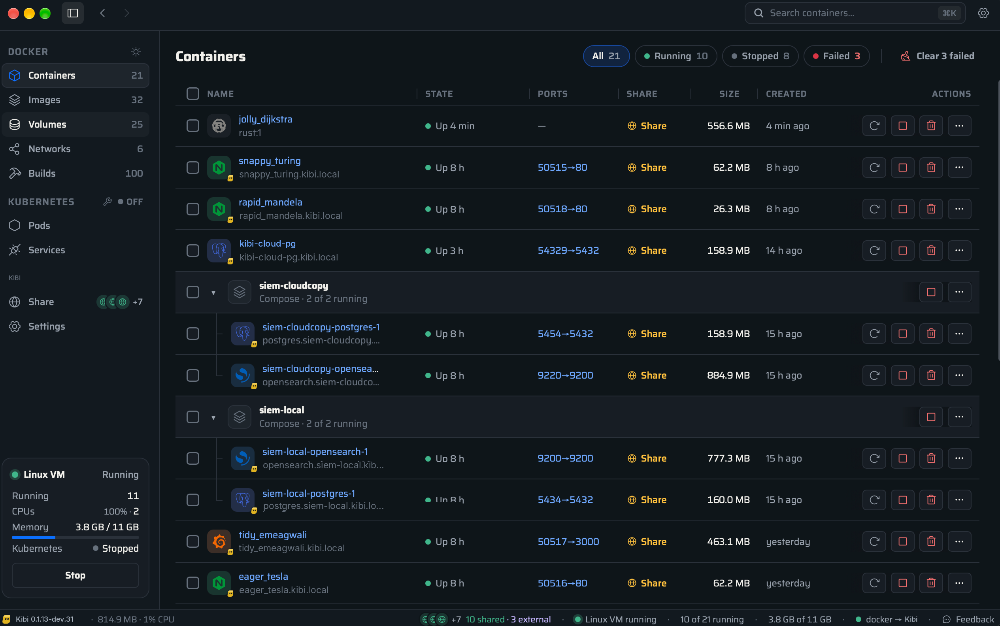

<p align="center">
  <picture>
    <source media="(prefers-color-scheme: dark)" srcset="brand/logo/kibi-horizontal-dark.svg">
    
  </picture>
</p>

<p align="center">
  <b>A tiny, fast container runtime for macOS, Windows and Linux.</b><br>
  Runs your Docker images and works with the <code>docker</code> CLI, Compose and buildx you already use.
</p>

<p align="center">
  <a href="https://runkibi.kambiz.site/releases/">Download</a> ·
  <a href="docs/features.md">Features</a> ·
  <a href="docs/development.md">Build from source</a> ·
  <a href="https://github.com/libracoder/kibi/releases">Releases</a>
</p>

<p align="center">
  <a href="https://github.com/libracoder/kibi/releases/latest"></a>
  <a href="LICENSE"></a>
  <a href="#in-your-language"></a>
</p>

<p align="center">
  🇬🇧 🇮🇩 🇩🇪 🇪🇸 🇫🇷 🇮🇹 🇵🇱 🇧🇷 🇻🇳 🇹🇷 🇷🇺 🇸🇦 🇯🇵 🇰🇷 🇨🇳 🇹🇼<br>
  <sub>Kibi speaks 38 languages. <a href="#in-your-language">Is yours one?</a></sub>
</p>

<p align="center">
  
</p>

---

Kibi is a lightweight replacement for Docker Desktop and OrbStack, written in
Rust. It runs containers in one small Linux VM (or straight on the kernel on
Linux) and speaks the Docker Engine API, so your tools just work.

Kibi is this branch’s name because “kiri” is a rude word in Persian. The branch
exists so the project can be used in Iran, with no other changes. It is kept in
step with upstream [Kiri](https://github.com/libracoder/kiri); the only intended
difference is this rebrand. Upstream’s name comes from the Igbo word
*ntakịrị*, “small”. Kibi’s does not.

## Why Kibi

- **Fast**: a container starts and exits in about 2.5 ms through the Docker API. That's around 80 times faster than Docker Desktop.
- **Light**: the VM sleeps after 60 s idle, the daemon stays at about 15 MB, and it wakes in about 0.15 s.
- **Compatible**: `docker`, Compose, buildx, `docker login` and amd64 images through Rosetta.
- **Local domains**: `http://<name>.kibi.local`, with HTTPS from Kibi's own certificate authority.
- **More than containers**: a one-command Kubernetes cluster and Linux machines.
- **A native window** for containers, images, volumes and networks, plus a menu bar item.
- **In your language**: 38 languages, on macOS, Windows and Linux alike.

### In your language

Kibi's window and setup come in these languages. It follows your system's language, and you can change it in Settings → Appearance. In Arabic, Persian and Central Kurdish the whole window reads right to left.

| | Language | | Language | | Language | | Language |
|---|---|---|---|---|---|---|---|
| 🇬🇧 | English | 🇳🇴 | Norsk bokmål | 🇧🇬 | Български | 🇮🇳 | తెలుగు |
| 🇮🇩 | Bahasa Indonesia | 🇵🇱 | Polski | 🇷🇺 | Русский | 🇹🇭 | ไทย |
| 🇦🇩 | Català | 🇧🇷 | Português (Brasil) | 🇺🇦 | Українська | 🇱🇦 | ລາວ |
| 🇨🇿 | Čeština | 🇷🇴 | Română | 🇰🇿 | Қазақша | 🇯🇵 | 日本語 |
| 🇩🇪 | Deutsch | 🇦🇱 | Shqip | 🇸🇦 | العربية | 🇰🇷 | 한국어 |
| 🇪🇸 | Español | 🇸🇮 | Slovenščina | 🇮🇷 | فارسی | 🇨🇳 | 简体中文 |
| 🇫🇷 | Français | 🇫🇮 | Suomi | 🇮🇶 | کوردیی ناوەندی | 🇹🇼 | 繁體中文 |
| 🇮🇹 | Italiano | 🇻🇳 | Tiếng Việt | 🇮🇳 | हिन्दी | 🇪🇹 | አማርኛ |
| 🇱🇹 | Lietuvių | 🇹🇷 | Türkçe | 🇧🇩 | বাংলা |  |  |
| 🇭🇺 | Magyar | 🇬🇷 | Ελληνικά | 🇮🇳 | தமிழ் |  |  |

Missing yours? Translations live in [`crates/kibi/src/ui/lang`](crates/kibi/src/ui/lang); see [Contributing](#contributing).

## Install

| Platform | Get it |
|----------|--------|
| macOS 14+ (Apple silicon or Intel) | `.dmg` from [runkibi.kambiz.site/releases](https://runkibi.kambiz.site/releases/) |
| Windows 10 and 11 (x86-64 or Arm, through WSL 2) | `.msi` from [runkibi.kambiz.site/releases](https://runkibi.kambiz.site/releases/) |
| Linux (Ubuntu, Fedora and others) | `.deb` or `.rpm` from [runkibi.kambiz.site/releases](https://runkibi.kambiz.site/releases/) |

The first time you open Kibi, it sets up a `kibi` Docker context. Kibi updates itself, and checks each new release's signature first.

## Quick start

```sh
docker --context kibi run --rm alpine echo hello
docker --context kibi compose up -d
kibi k8s start                      # single-node Kubernetes as the `kibi` kubectl context
kibi machine create dev --distro ubuntu && kibi machine shell dev
kibi import                         # bring images, volumes and containers over from OrbStack or Docker Desktop
```

Docker's commands also work as `kibi` commands (`kibi run`, `kibi ps`,
`kibi compose up`, and so on), and always target Kibi.

## Numbers

`alpine` running `true` and removed, median of 30 runs, same `docker` CLI for all three:

|                | Docker Engine API | `docker` CLI |
|----------------|------------------:|-------------:|
| **Kibi**       | **2.55 ms**       | **14.2 ms**  |
| Docker Desktop | 213 ms            | 243 ms       |
| OrbStack       | 380 ms            | 442 ms       |

Method and every other figure are in [`bench/results.json`](bench/results.json). Rerun with `kibi bench`.

## How it works

```
docker CLI ─┐
compose ────┼─ Docker Engine API ─► kibi daemon ── vsock ──► guest agent (PID 1)
buildx ─────┤                         owns the VM           clone3 → container
kibi UI ────┘
```

The VM uses a custom 10 MB kernel, and its PID 1 is a ~900 KB Rust agent.
That agent starts containers with a single `clone3` into namespaces and a
cgroup. There's no runc, no shim and no dockerd. More detail is in
[docs/development.md](docs/development.md#architecture).

## Documentation

- [Features](docs/features.md): everything supported today, release files and known issues
- [Development](docs/development.md): building, running from source, architecture and repository layout
- [Release notes](docs/releases)

## Roadmap

Next is a built-in builder. Kibi will serve Docker's own build endpoints, so
buildx uses its docker driver against Kibi as it does against Docker
Desktop. This brings `host-gateway` support to BuildKit builds, and images
load straight into Kibi.

## Contributing

Issues and pull requests are welcome. See [CONTRIBUTING.md](CONTRIBUTING.md)
and the [Code of Conduct](CODE_OF_CONDUCT.md). To report a vulnerability
privately, see [SECURITY.md](SECURITY.md).

## License

[Apache-2.0](LICENSE). Third-party licences are in [NOTICE](NOTICE). The guest
kernel is Linux (GPL-2.0); its config, patches and the source offer are in
[`guest/kernel`](guest/kernel).

The name "Kibi" and the Kibi logo are not covered by the licence. Forks are
welcome, under a different name and logo.
